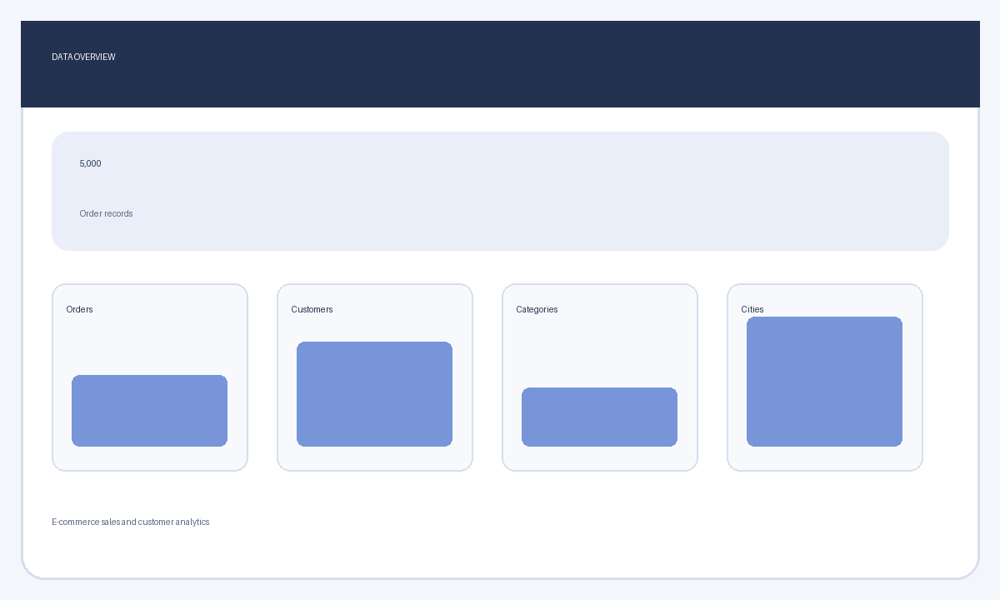
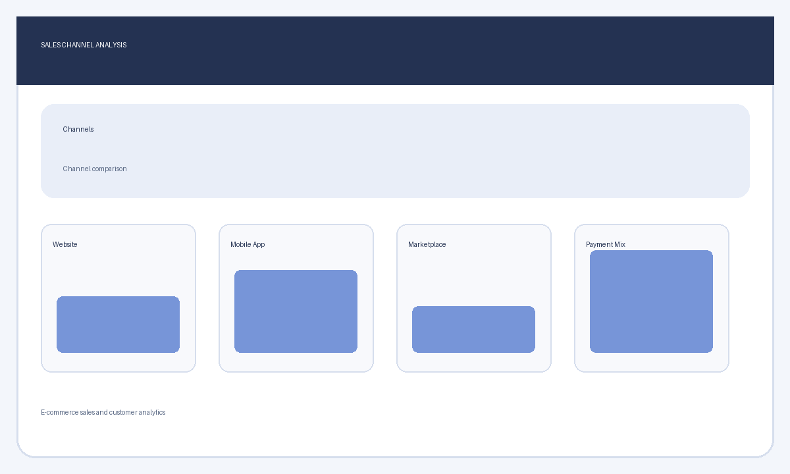

# E-Commerce Sales & Customer Analytics

## Project Overview
This project analyzes e-commerce transactions to understand revenue trends, customer purchasing behavior, product performance, and sales channel performance.

## Objectives
- Analyze revenue and profit trends over time
- Identify top-performing categories and products
- Explore customer purchasing patterns
- Compare sales channels and payment methods
- Examine discount patterns and profitability
- Present business performance through visualizations and a dashboard

## Tools & Technologies
- Python
- Pandas
- NumPy
- SQL
- Excel
- Power BI
- Matplotlib
- Seaborn

## Project Workflow
1. Data Overview
2. Data Cleaning & Preprocessing
3. Exploratory Data Analysis
4. Revenue & Profit Analysis
5. Product & Customer Analysis
6. Dashboard Development
7. Business Insights & Recommendations

## Dashboard Screenshots

### Data Overview

### Revenue Trend

### Product Performance

### Customer Analytics

### Sales Channel Analysis

### Dashboard & Insights

## Author
Soham Sutar
